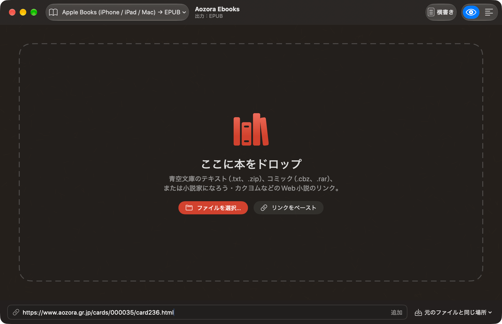

# Aozora Ebooks


青空文庫のテキスト・Web小説・コミックをEPUB 3に変換するmacOSアプリ。[AozoraEpub3](https://github.com/hmdev/AozoraEpub3)のSwift移植版。Java不要。

> **EN:** Native macOS rewrite of AozoraEpub3. Converts Aozora Bunko texts, web novels and comics to EPUB 3 with vertical Japanese typesetting. Same output as the original, no Java. Japanese and English UI.



## 機能

- 入力：`.txt` `.zip` `.txtz` `.rar` `.cbz`、フォルダ、青空文庫の図書カード、Web小説のURL（なろう、カクヨム、ハーメルンなど）
- 端末プリセット：Apple Books、Kindle（Send to Kindle）、Kobo、AozoraEpub3の旧プリセット
- 変換前の確認：タイトル・ふりがな・表紙（切り抜き／挿絵から選択／自動生成）・目次
- AozoraEpub3の全設定（約130項目）、プロファイル、`.ini`の読み込み・書き出し
- 出力はAozoraEpub3 1.1.0b46と同一（対応表：[FEATURES.md](FEATURES.md)）
- 日本語／英語UI（macOSの言語に従う。設定 ▸ 一般 ▸ 言語で変更可）

## インストール

1. [Releases](../../releases)から`Aozora-Ebooks-<version>.zip`をダウンロード → アプリケーションフォルダへ
2. macOS 15以降（Apple silicon／Intel）
3. 公証なしのため初回はブロックされる：一度開いて「完了」→ システム設定 ▸ プライバシーとセキュリティ ▸「このまま開く」
   - または `xattr -dr com.apple.quarantine "/Applications/Aozora Ebooks.app"`

## コマンドライン

`aozora-cli-<version>.zip`（`aozora`と`AozoraEbooks_AozoraKit.bundle`は同じフォルダに置く）

```sh
aozora -d ~/Books ningen_shikkaku.txt
aozora -i AozoraEpub3.ini -ext .kepub.epub book.zip
aozora https://ncode.syosetu.com/n5606cq/
```

オプションはAozoraEpub3と同じ（`-i` `-d` `-enc` `-ext` `-t` `-tf` `-c` `-of` `-hor`）。`-i`はAozoraEpub3の`.ini`・プロファイル・プリセットをそのまま読める。

## 開発

macOS 15+、Xcode 16+、[XcodeGen](https://github.com/yonaskolb/XcodeGen)

```sh
make app    # アプリをビルド
make run    # ビルドして起動
make cli    # CLIをビルド
make test   # テスト
make dist   # リリース用zip（.build/dist）
```

- Xcodeで開く：`cd App && xcodegen generate && open AozoraEbooks.xcodeproj`
- 翻訳：`App/Resources/Localizable.xcstrings`、`Sources/AozoraKit/Localizable.xcstrings`
- リリース：`App/project.yml`の`MARKETING_VERSION`を上げて`make dist` → `gh release create v<version> .build/dist/*`

## クレジット

GPL-3.0

- [AozoraEpub3](https://github.com/hmdev/AozoraEpub3)（hmdev）：変換エンジン、テンプレート、注記表、端末プリセットの移植元
- [kyukyunyorituryo/AozoraEpub3](https://github.com/kyukyunyorituryo/AozoraEpub3)：Web小説のサイト定義、ページ送り対応
- [cjkvi](https://github.com/cjkvi/cjkvi-data)：外字表（AozoraEpub3経由）
- [ZIPFoundation](https://github.com/weichsel/ZIPFoundation)、[SwiftSoup](https://github.com/scinfu/SwiftSoup)
